# S01 evidence figure gallery

Synthetic software evidence only. Times New Roman (minimum 14-point text), editable SVG/PDF and 1000 dpi PNG exports accompany every figure. Embedded images are explicitly low-resolution screen previews; use the publication PNG/PDF/SVG links for submission. Captions define interpretation limits.

## F00_environment

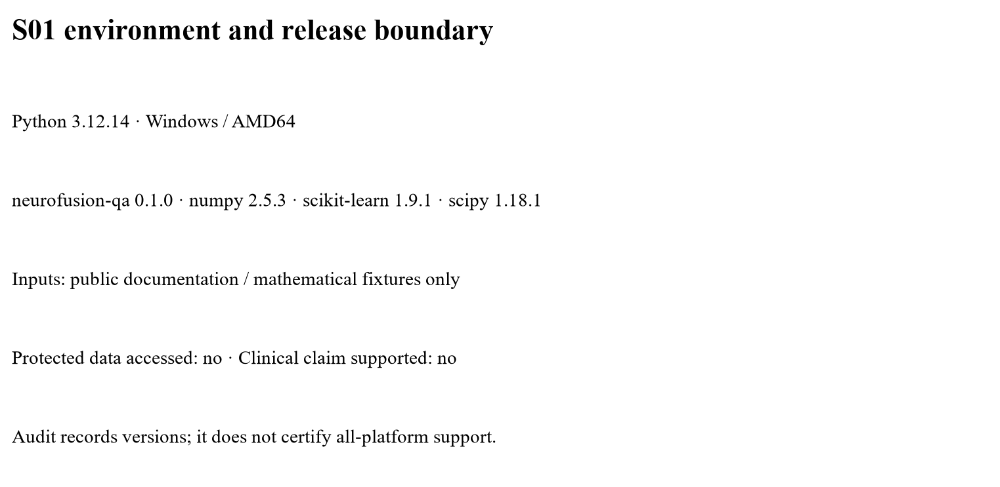

Environment and boundary audit for this execution, not a portability certification.

[1000 DPI PNG](F00_environment.png) · [SVG](F00_environment.svg) · [PDF](F00_environment.pdf) · [Caption and source hashes](F00_environment.caption.json)

## F01_feature_contracts

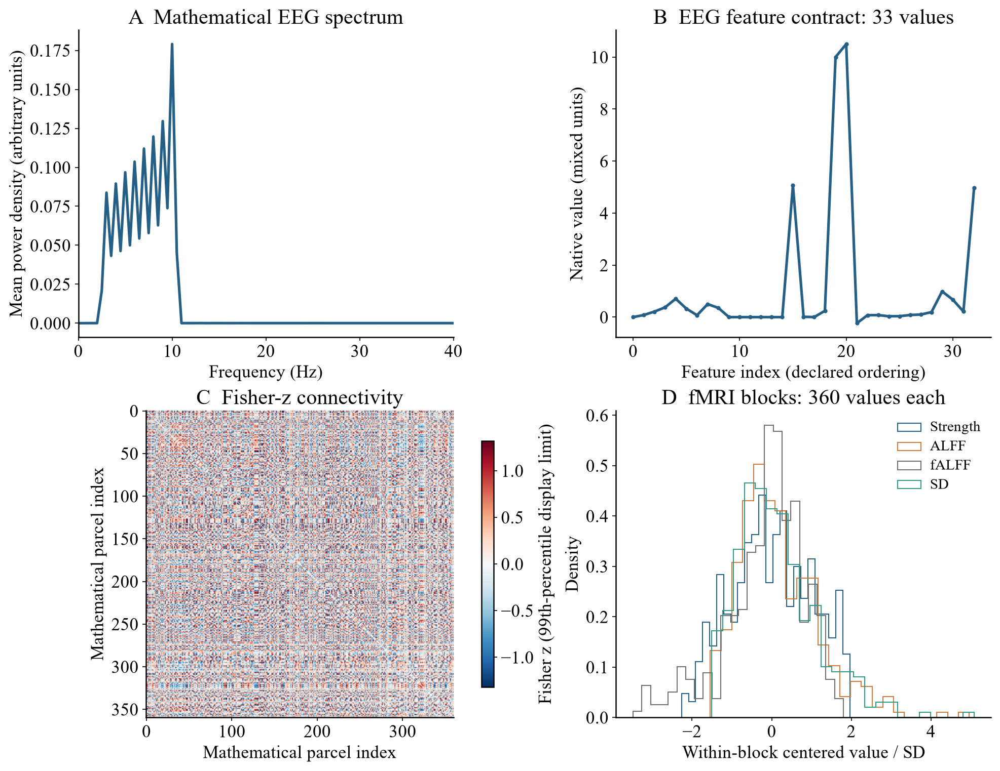

Deterministic mathematical inputs, identical to notebook 01. Mixed EEG feature units must not be compared as effect sizes; fMRI block distributions are normalized only for display; connectivity is not an anatomical brain map.

[1000 DPI PNG](F01_feature_contracts.png) · [SVG](F01_feature_contracts.svg) · [PDF](F01_feature_contracts.pdf) · [Caption and source hashes](F01_feature_contracts.caption.json)

## F02_qc_boundaries

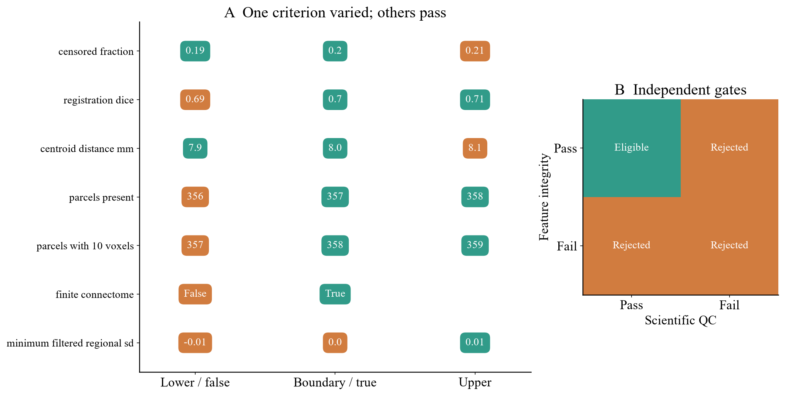

Seven declared fMRI QC criteria checked at/around their boundaries. Green passes; orange rejects. QC and feature integrity are distinct: neither substitutes for the other. Binary criterion has only two cases; values are in each criterion's native units.

[1000 DPI PNG](F02_qc_boundaries.png) · [SVG](F02_qc_boundaries.svg) · [PDF](F02_qc_boundaries.pdf) · [Caption and source hashes](F02_qc_boundaries.caption.json)

## F03_quality_response

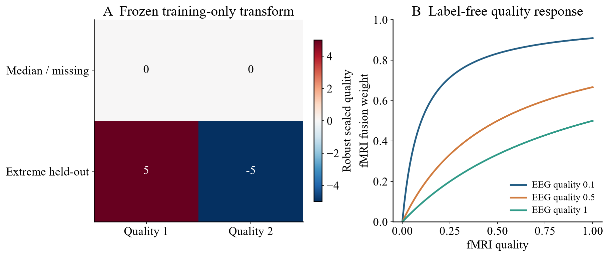

Missing quality imputes to the training median; extremes clip to [-5,5]. Fusion response follows q_fMRI/(q_EEG+q_fMRI); both-zero quality is rejected, not drawn. Monotonic response is a contract, not proof of predictive benefit.

[1000 DPI PNG](F03_quality_response.png) · [SVG](F03_quality_response.svg) · [PDF](F03_quality_response.pdf) · [Caption and source hashes](F03_quality_response.caption.json)

## F04_provenance_lineage

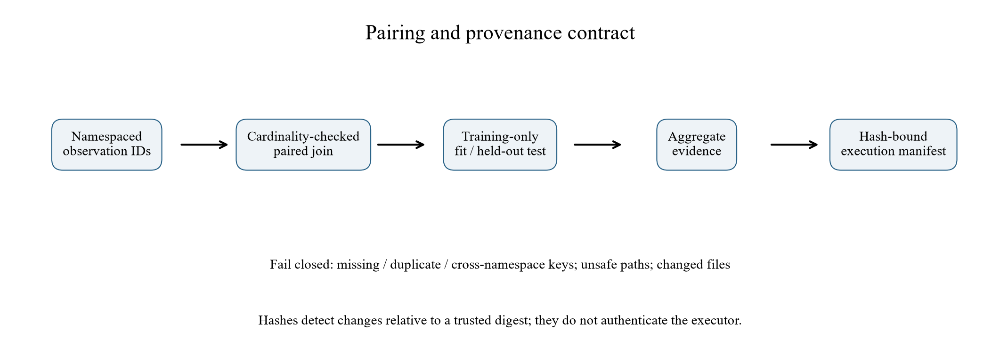

Conceptual flow of the executed tutorial's identity and manifest contract; actual failure checks accompany the schematic. A manifest is not an authenticated signature.

[1000 DPI PNG](F04_provenance_lineage.png) · [SVG](F04_provenance_lineage.svg) · [PDF](F04_provenance_lineage.pdf) · [Caption and source hashes](F04_provenance_lineage.caption.json)

## F05_tutorial_accounting

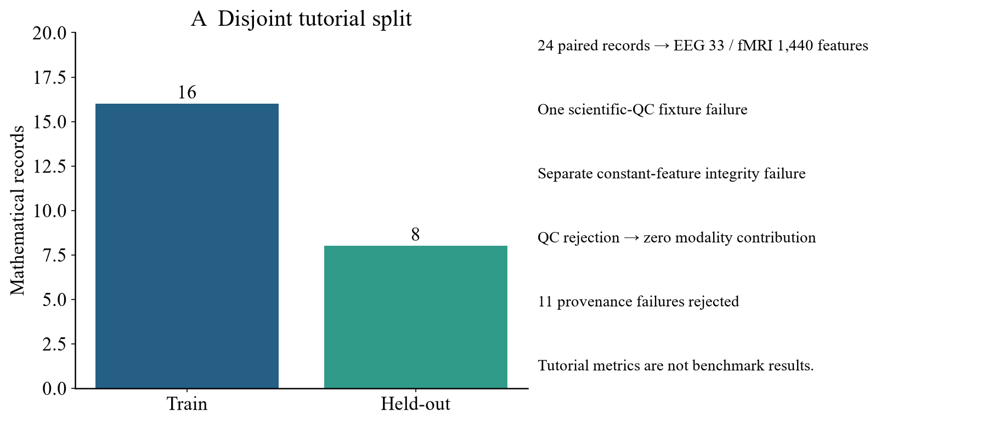

Tutorial accounting from executed evidence: disjoint 16/8 split, actual feature shapes, separate QC/integrity checks and fail-closed provenance demonstrations. Small, deliberately easy signals cannot establish prediction performance.

[1000 DPI PNG](F05_tutorial_accounting.png) · [SVG](F05_tutorial_accounting.svg) · [PDF](F05_tutorial_accounting.pdf) · [Caption and source hashes](F05_tutorial_accounting.caption.json)

## F06_metrics_informative

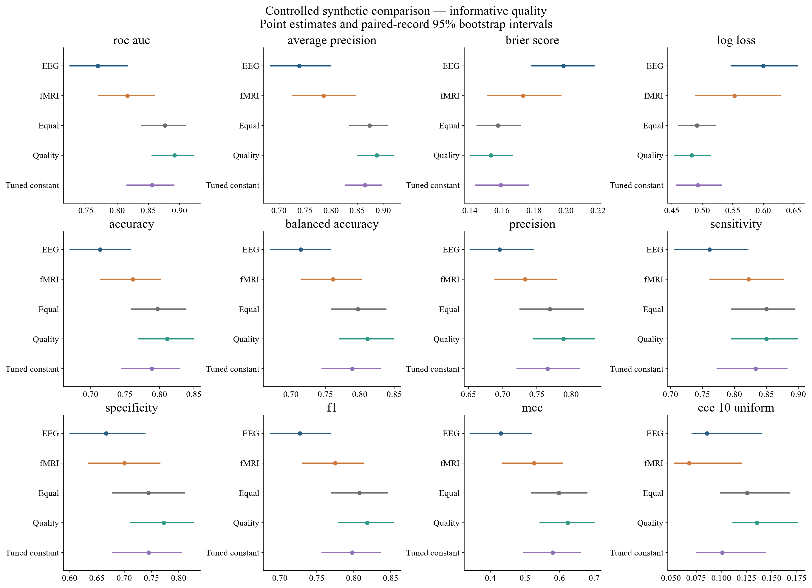

All 12 predeclared metrics, five methods, informative quality; 360 balanced mathematical records, three seeds, shared 4-fold/2-repeat nested predictions. 1,000 seed/class-stratified record bootstrap resamples of averaged predictions: conditional on fitted models, not model-refitting or population uncertainty. Lower is better for Brier, log loss, ECE; higher for the other metrics. Threshold metrics use majority decisions from training-OOF thresholds (ties positive), not 0.5 on averaged probabilities. Undefined precision/F1/MCC use zero.

[1000 DPI PNG](F06_metrics_informative.png) · [SVG](F06_metrics_informative.svg) · [PDF](F06_metrics_informative.pdf) · [Caption and source hashes](F06_metrics_informative.caption.json)

## F06_metrics_misleading

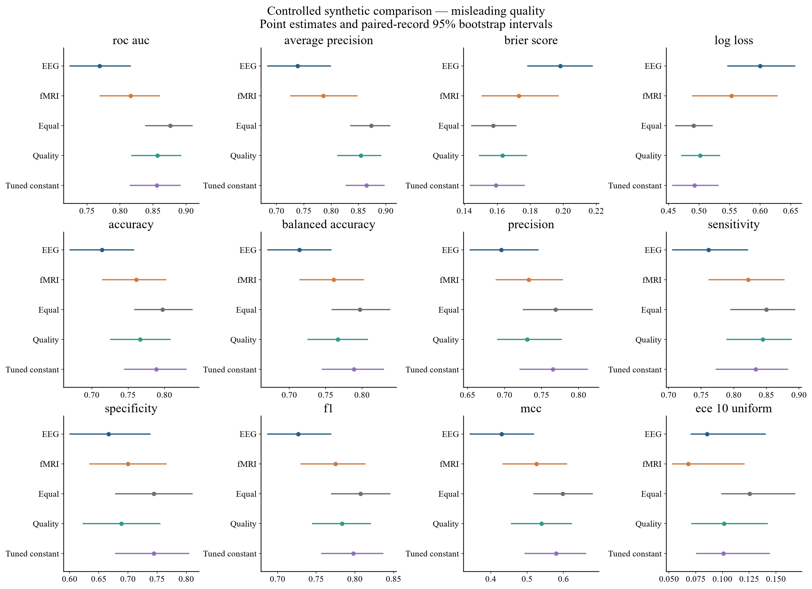

All 12 predeclared metrics, five methods, misleading quality; 360 balanced mathematical records, three seeds, shared 4-fold/2-repeat nested predictions. 1,000 seed/class-stratified record bootstrap resamples of averaged predictions: conditional on fitted models, not model-refitting or population uncertainty. Lower is better for Brier, log loss, ECE; higher for the other metrics. Threshold metrics use majority decisions from training-OOF thresholds (ties positive), not 0.5 on averaged probabilities. Undefined precision/F1/MCC use zero.

[1000 DPI PNG](F06_metrics_misleading.png) · [SVG](F06_metrics_misleading.svg) · [PDF](F06_metrics_misleading.pdf) · [Caption and source hashes](F06_metrics_misleading.caption.json)

## F06_metrics_unrelated

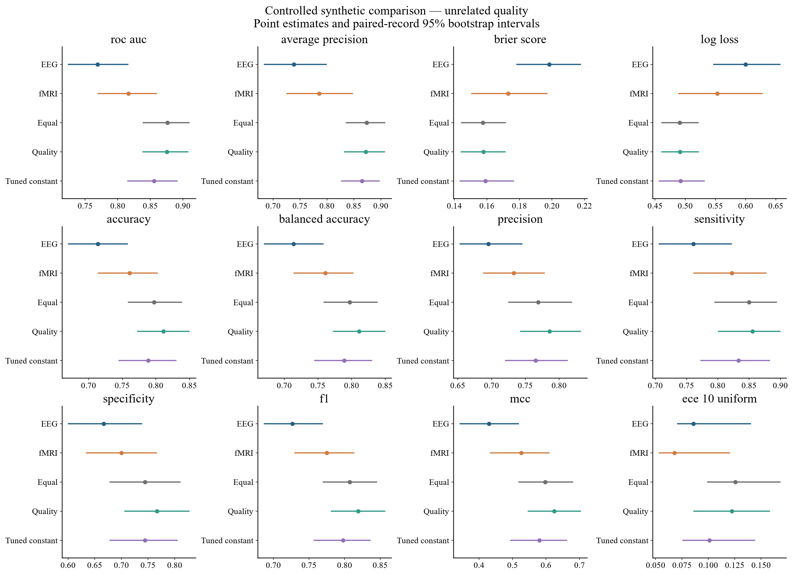

All 12 predeclared metrics, five methods, unrelated quality; 360 balanced mathematical records, three seeds, shared 4-fold/2-repeat nested predictions. 1,000 seed/class-stratified record bootstrap resamples of averaged predictions: conditional on fitted models, not model-refitting or population uncertainty. Lower is better for Brier, log loss, ECE; higher for the other metrics. Threshold metrics use majority decisions from training-OOF thresholds (ties positive), not 0.5 on averaged probabilities. Undefined precision/F1/MCC use zero.

[1000 DPI PNG](F06_metrics_unrelated.png) · [SVG](F06_metrics_unrelated.svg) · [PDF](F06_metrics_unrelated.pdf) · [Caption and source hashes](F06_metrics_unrelated.caption.json)

## F07_paired_brier

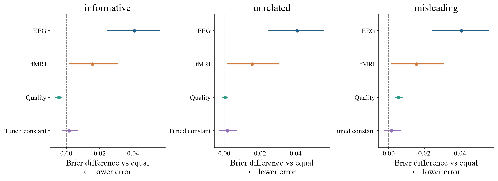

Paired candidate-minus-equal Brier differences with 95% record-bootstrap intervals. Negative is lower error. Same resampled indices for every method; intervals are descriptive, no multiplicity-adjusted significance claim. Misleading-quality failures remain visible.

[1000 DPI PNG](F07_paired_brier.png) · [SVG](F07_paired_brier.svg) · [PDF](F07_paired_brier.pdf) · [Caption and source hashes](F07_paired_brier.caption.json)

## F08_discrimination_curves

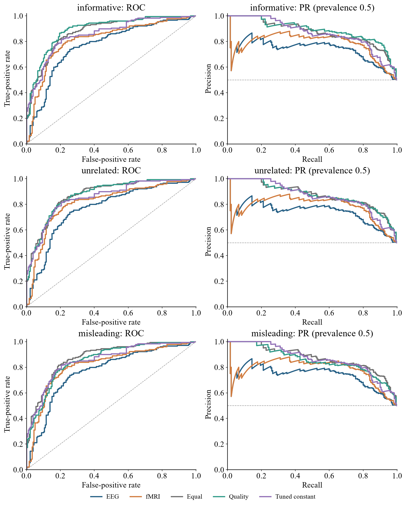

ROC and precision-recall curves from repeat-averaged held-out predictions. Random reference lines are diagonal ROC and prevalence 0.5 for PR. Curves have no pointwise CI bands; scalar AUC/AP intervals are in F06.

[1000 DPI PNG](F08_discrimination_curves.png) · [SVG](F08_discrimination_curves.svg) · [PDF](F08_discrimination_curves.pdf) · [Caption and source hashes](F08_discrimination_curves.caption.json)

## F09_calibration_support

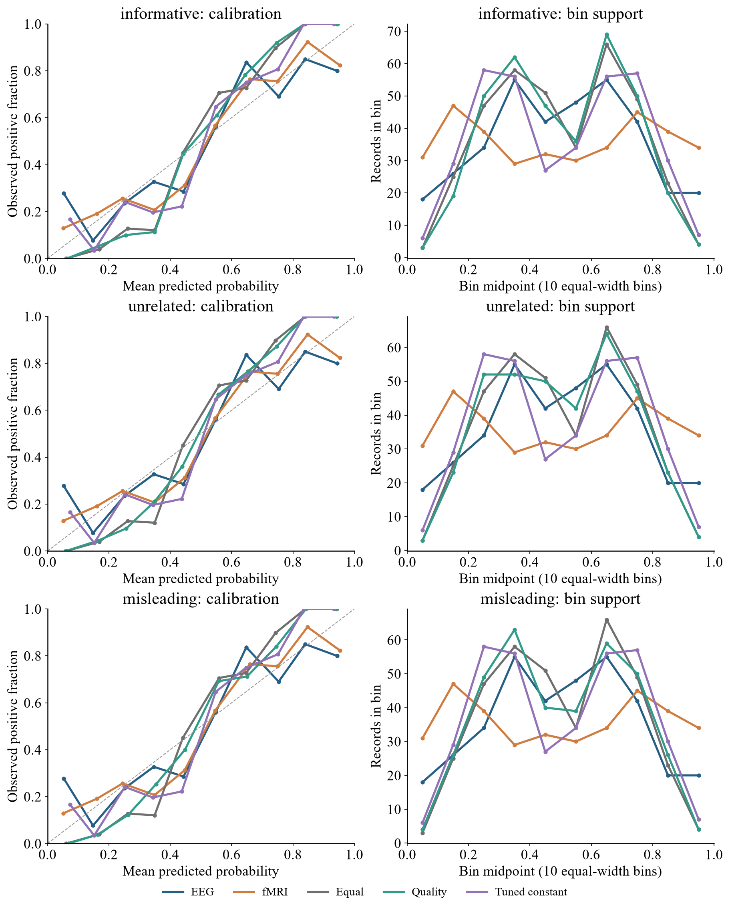

Ten equal-width reliability bins paired with their actual support. Empty bins are omitted from calibration curves but retained as zero in count panels; probability 1 belongs to the last bin. These curves are descriptive, with no bin-wise uncertainty claim; ECE depends on binning.

[1000 DPI PNG](F09_calibration_support.png) · [SVG](F09_calibration_support.svg) · [PDF](F09_calibration_support.pdf) · [Caption and source hashes](F09_calibration_support.caption.json)

## F10_confusion_counts

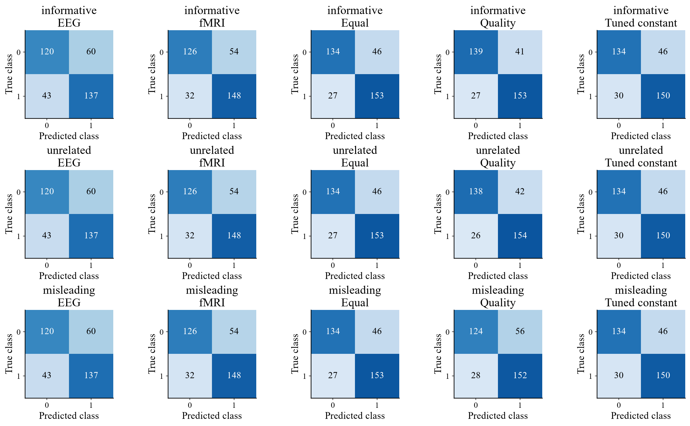

All thresholded confusion matrices, counts on a common 0–180 color scale, 180 true records per class. Row=true/column=predicted. Decisions are majority votes from training-only OOF threshold selection; no threshold tuned on held-out labels.

[1000 DPI PNG](F10_confusion_counts.png) · [SVG](F10_confusion_counts.svg) · [PDF](F10_confusion_counts.pdf) · [Caption and source hashes](F10_confusion_counts.caption.json)

## F11_gate_validity

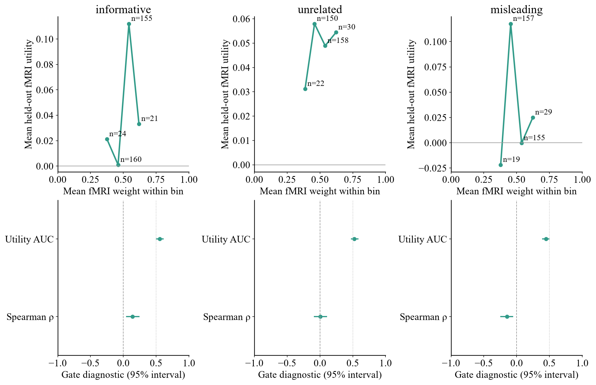

Utility is |y−p_EEG|−|y−p_fMRI|, computed from held-out unimodal predictions independently of the gate. Upper row: descriptive means in weight bins, no CI. Lower: utility-sign AUC (chance .5) and Spearman association (null 0), paired-record bootstrap intervals. Quality monotonicity alone does not validate utility.

[1000 DPI PNG](F11_gate_validity.png) · [SVG](F11_gate_validity.svg) · [PDF](F11_gate_validity.pdf) · [Caption and source hashes](F11_gate_validity.caption.json)

## F12_nested_tuning

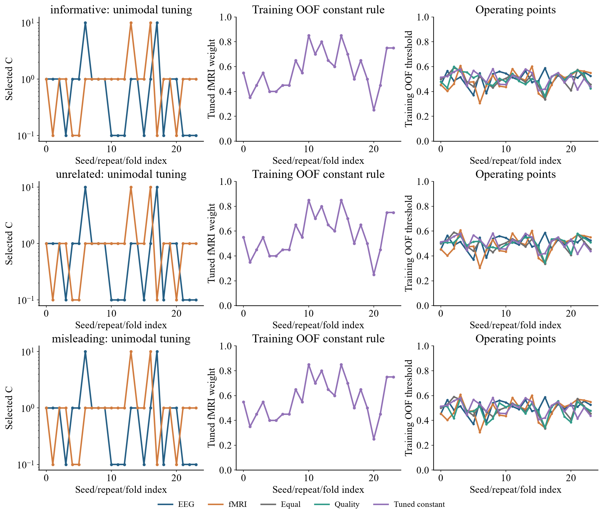

Training-only selected C, constant fMRI weight and operating thresholds for all 24 outer folds per quality condition. The JSON also records split hashes/counts; identical folds and shared unimodal predictions are tested. Fold points are dependent and are not independent samples for inference.

[1000 DPI PNG](F12_nested_tuning.png) · [SVG](F12_nested_tuning.svg) · [PDF](F12_nested_tuning.pdf) · [Caption and source hashes](F12_nested_tuning.caption.json)

## F13_interface_robustness

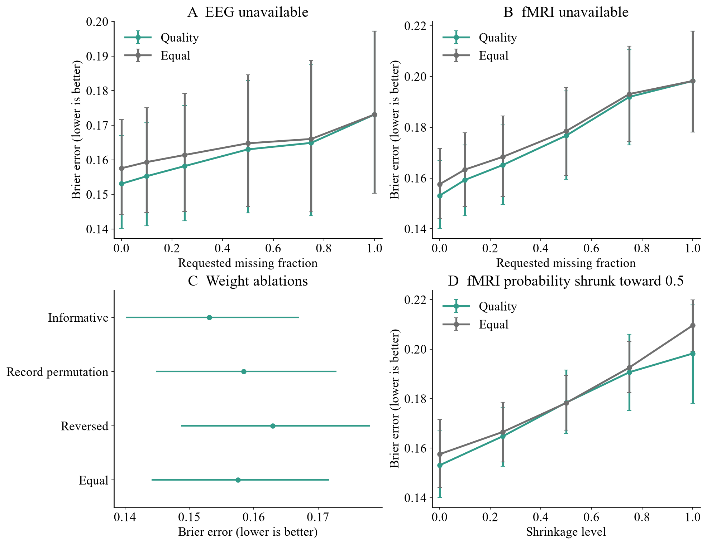

Controlled prediction-interface audit, not EEG/fMRI signal corruption or external validation. Missingness uses shared nested random masks (actual counts in JSON); both methods remove unavailable modalities. Shrinkage also scales quality-aware fMRI reliability mass; no model retraining. Apply perturbation per repeat before averaging. Points/95% intervals use 1,000 seed/class-stratified record resamples conditional on fitted models; intervals are not paired-difference significance tests. Both-unavailable and zero-reliability cases reject explicitly.

[1000 DPI PNG](F13_interface_robustness.png) · [SVG](F13_interface_robustness.svg) · [PDF](F13_interface_robustness.pdf) · [Caption and source hashes](F13_interface_robustness.caption.json)

## F14_cpu_kernel_timing

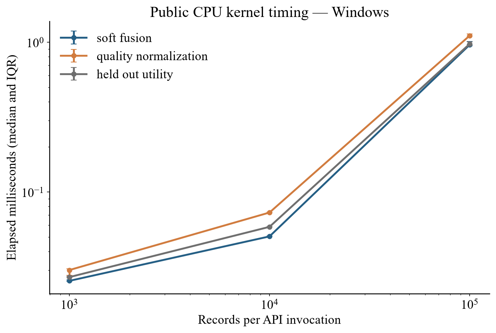

Measured public-API kernel calls only: 3 warmups, 15 repetitions, one BLAS/OpenMP thread; inputs prepared outside timed region. Bars are timing IQR, not confidence intervals. Runtime-specific environment and raw summary ranges are in JSON. Not a full-pipeline benchmark, GPU result, cross-method speed claim or peak-memory measurement.

[1000 DPI PNG](F14_cpu_kernel_timing.png) · [SVG](F14_cpu_kernel_timing.svg) · [PDF](F14_cpu_kernel_timing.pdf) · [Caption and source hashes](F14_cpu_kernel_timing.caption.json)
